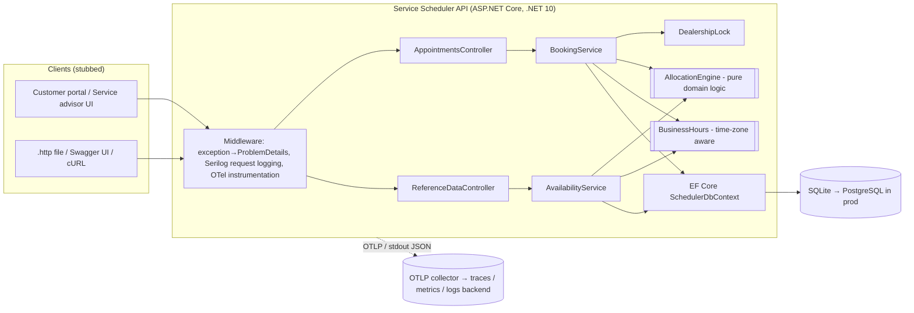
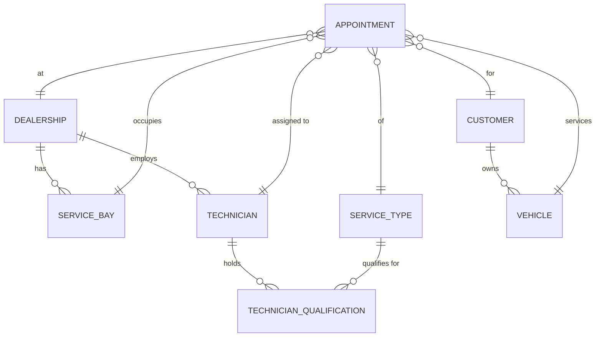
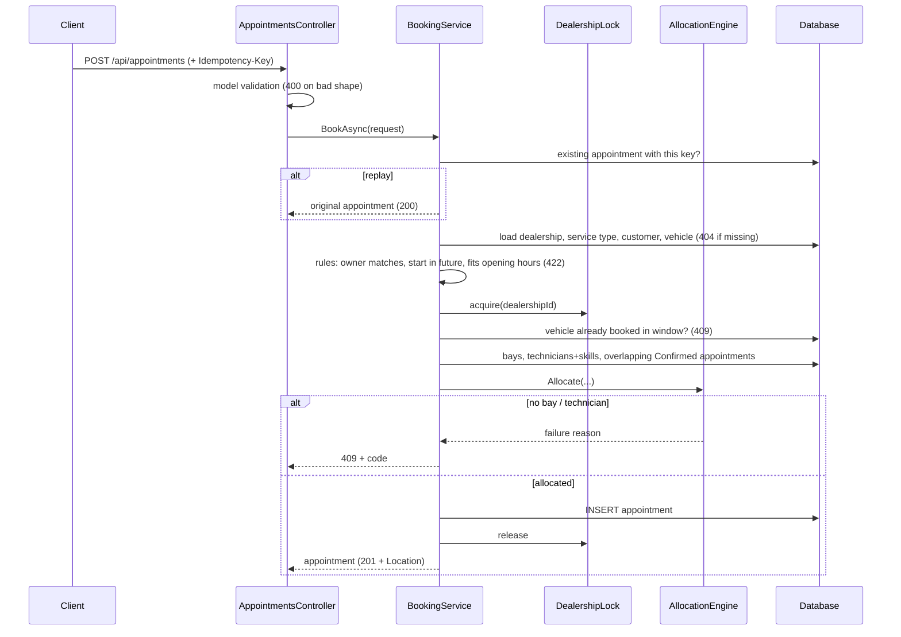

# System Design: Unified Service Scheduler (Keyloop Scenario A)

## 1. Problem and scope

Dealerships book service work manually, so they double-book bays and hand jobs to technicians who aren't qualified for them. The scheduler replaces that process with an API that:

1. accepts a booking request for a specific **customer + vehicle + service type + dealership + start time**,
2. checks that **a service bay and a qualified technician are both free for the entire service duration**, and
3. on success persists an **Appointment** linking customer, vehicle, technician and bay.

**Implemented layer:** the backend (REST API and persistent database). The client side is stubbed with an OpenAPI document and Swagger UI, a `.http` file of runnable requests, and HTTP-level integration tests.

## 2. Architecture

**Target production deployment:** several stateless API replicas behind a load balancer, PostgreSQL (managed, with a read replica for availability queries), an OpenTelemetry Collector sidecar, and structured logs shipped from stdout.

## 3. Components

| Component | Role |
|---|---|
| **AppointmentsController** | `POST /api/appointments` (book), `GET` by id / list, `DELETE` (cancel). Validates input shape (400) and maps the outcome to `201 Created`, or to `200 OK` for an idempotent replay. |
| **ReferenceDataController** | Read-only lists of dealerships (with their bays and technician skills), service types and customers/vehicles, plus `GET /api/dealerships/{id}/availability`, which returns bookable slots for a date. |
| **BookingService** | Orchestrates a booking: idempotency lookup → reference validation → business rules (future start, vehicle ownership, opening hours) → per-dealership lock → vehicle clash check → allocation → insert. Also handles cancellation. Emits metrics and spans. |
| **AvailabilityService** | Loads a dealership's day once and evaluates every 30-minute candidate slot in memory with the *same* engine used for booking, so the slots it advertises are slots that will be accepted. |
| **AllocationEngine** | **Pure function**, with no I/O. It uses half-open interval overlap `[start, end)`, so back-to-back bookings don't conflict. It picks the lowest-id free bay and the lowest-id free technician *qualified for the service type*. On failure it returns a precise reason: `no_bay_available`, `no_technician_available` or `no_capacity`. |
| **BusinessHours** | Interprets opening hours in the dealership's **local time zone**, including daylight-saving changes. The whole service must fit inside a single local day's opening hours. |
| **DealershipLock** | Serialises the check-then-insert critical section **per dealership**, so concurrent requests can never be given the same bay or technician. Different dealerships never block each other. |
| **SchedulerDbContext** | EF Core mapping, indexes (`DealershipId, StartUtc, EndUtc` for the overlap query; a unique `IdempotencyKey`), and UTC round-tripping. |
| **SchedulingExceptionHandler** | Converts business failures to RFC 7807 `application/problem+json` with a stable `code` and a `traceId`. Unexpected errors return a generic 500 and are logged, without leaking internals. |

### Domain model

`Appointment` stores `StartUtc`/`EndUtc` (UTC, half-open), `Status` (`Confirmed` | `Cancelled`), `CreatedUtc` and an optional `IdempotencyKey`. The end time is derived from the service type's `DurationMinutes` at booking time, so later changes to a service type's duration don't rewrite history.

## 4. Data flow: booking an appointment

Availability (`GET /api/dealerships/{id}/availability`) uses three queries for the whole day and then evaluates all candidate slots in memory, so its cost doesn't grow with the number of slots.

## 5. Key decisions and assumptions

The brief is intentionally ambiguous. These are the assumptions I made:

| # | Assumption / decision | Rationale |
|---|---|---|
| A1 | Each service type has a **fixed duration**, and one appointment uses exactly **one bay and one technician** for that whole duration. | Simplest model that meets "entire service duration". Multi-stage jobs are a future extension. |
| A2 | **Any bay can take any service type**. Only technicians carry qualifications. | The brief only mentions qualified technicians. Bay capabilities (e.g. an EV lift) could be added as a bay–service-type join, mirroring technician qualifications. |
| A3 | Technicians and bays are available whenever the dealership is open: no shifts, breaks or holidays. | Technician rosters belong to another system. The engine takes resources as input, so adding a roster is a pre-filter. |
| A4 | Opening hours are the same every day, in the dealership's **local time zone**, and a job must finish the same local day it starts. | Avoids overnight jobs. DST is handled through `TimeZoneInfo`. |
| A5 | Customers, vehicles, dealerships and resources are **reference data owned elsewhere** (DMS/CRM). They're seeded here and only read. | Keeps the scope on scheduling. |
| A6 | Allocation is **deterministic (lowest id)**. | Predictable and testable. The engine is the single place to plug in smarter strategies (load-balancing, keeping specialists free). |
| A7 | A vehicle can't have two overlapping confirmed appointments, even at different dealerships. | It can't physically be in two places at once. |
| A8 | Times are exchanged as ISO-8601 with an offset and stored in UTC. The API returns UTC. | Unambiguous. Clients localise for display. |
| A9 | Cancelling is a **soft state change** (`Cancelled`) that releases resources, and it's idempotent. | Keeps an audit trail. |
| A10 | `409 Conflict` means "valid request, no capacity". `422` means a business-rule violation. `404` means unknown references. `400` means a malformed request. | Clients can tell "try another time" apart from "fix your request". |

### Concurrency and double-booking (the critical risk)

Checking availability and then inserting is a classic race: two requests can both see a bay as free. The implementation closes it with a **per-dealership async lock** around check + insert. This guarantee only holds **within a single instance**, which is acceptable for the SQLite build. The concurrency test fires 10 simultaneous requests at 3 units of capacity and asserts exactly 3 succeed, each with a distinct bay and technician.

**When scaling to multiple replicas**, the lock moves into the database, which then becomes the source of truth:

- PostgreSQL **exclusion constraints**: `EXCLUDE USING gist (technician_id WITH =, tstzrange(start_utc, end_utc) WITH &&) WHERE (status = 'Confirmed')`, with the same constraint for `service_bay_id`. Even buggy code can't double-book; a violation maps to 409 and is retried once to pick another resource.
- Alternatively, `pg_advisory_xact_lock(dealership_id)` inside the transaction, which reproduces today's per-dealership lock semantics across instances.

The vehicle clash check (A7) runs under the *booking* dealership's lock, so two simultaneous requests for one vehicle at two different dealerships could in theory both succeed. The database constraint above (on `vehicle_id`) closes this gap in production.

### Reliability

- **Idempotency-Key** header on POST: client retries after timeouts can't create duplicate bookings. A unique index enforces this. The key is checked once on entry (fast path) and again inside the dealership lock, so a retry that arrives while the original is still in flight gets the original booking back, not a spurious `409 vehicle_already_booked`.
- Stateless API, and all state lives in the database, so it scales horizontally (see the concurrency notes above).
- `/health` checks database connectivity, for load balancer and Kubernetes probes.
- Input is validated at the edge, and all failures return structured problem details.

### Scalability and performance

- The overlap query is served by the composite index `(DealershipId, StartUtc, EndUtc)`, and only one dealership's window is ever scanned.
- The workload is naturally **partitioned by dealership**: the lock, the queries and a future sharding key all use it.
- Availability is read-heavy. It can go to a read replica, or behind a short-TTL cache invalidated on booking/cancel events.
- Lists are capped (`Take(500)`). Production would add cursor pagination.

### Maintainability

- Layering: Controllers (HTTP) → Application services (orchestration) → Domain (pure rules) → Data (EF Core).
- The core decision logic (`AllocationEngine`, `BusinessHours`) is pure and has its own unit tests.
- Time is injected through `TimeProvider`, so tests are deterministic.

## 6. Technology choices

| Technology | Why |
|---|---|
| **.NET 10 / ASP.NET Core (C#)** | LTS release; high-performance, strongly typed, first-class DI, OpenAPI, health checks and problem details out of the box. |
| **EF Core 10** | Productive data access with LINQ, migrations and provider portability. The same model runs on SQLite and PostgreSQL. |
| **SQLite** (dev/test) → **PostgreSQL** (prod) | SQLite is a zero-install persistent file DB, which keeps the challenge easy to run. PostgreSQL adds `tstzrange` exclusion constraints, the right production tool for double-booking prevention. |
| **Serilog** (compact JSON to stdout) | Structured, queryable logs. Standard 12-factor log shipping. |
| **OpenTelemetry** (traces + metrics, OTLP) | Vendor-neutral; works with Jaeger, Grafana, Azure Monitor, Datadog, etc. |
| **Microsoft.AspNetCore.OpenApi + Swagger UI** | Generated OpenAPI contract (`/openapi/v1.json`) acts as the client stub and documentation. |
| **xUnit + WebApplicationFactory + real SQLite** | Fast unit tests for pure logic. Integration tests exercise the real HTTP pipeline and real SQL rather than an in-memory fake. |

## 7. Observability strategy

| Signal | Implementation | Used for |
|---|---|---|
| **Logs** | Serilog compact JSON to stdout, with request logging per HTTP call (method, path, status, latency). Business events are logged with structured properties (`AppointmentId`, `BayId`, `TechnicianId`, rejection `Reason`). | Debugging and audit ("why was this rejected?"). |
| **Traces** | OpenTelemetry ASP.NET Core instrumentation plus a custom `BookAppointment` span (tag `dealership.id`, error status set to the rejection code). Exported via OTLP when `OTEL_EXPORTER_OTLP_ENDPOINT` is set. `traceId` is returned in every error body. | End-to-end latency. A support ticket's `traceId` leads straight to the trace and its logs. |
| **Metrics** | Meter `ServiceScheduler`: `appointments.booked` (by dealership), `appointments.rejected` (by reason), `appointments.booking.duration` (ms histogram). Plus standard ASP.NET Core HTTP metrics. | Dashboards and alerts: a spike in `no_technician_available` shows a dealership is under-staffed (a business insight, not just an ops one); p95 booking latency; 5xx rate. |
| **Health** | `GET /health` with a database check. | Liveness/readiness probes. |

Example alerts: 5xx rate > 1% over 5 minutes; p95 booking duration > 500 ms; rejected/booked ratio for one dealership > 50% over an hour (capacity problem).

## 8. Future extensions

Technician shifts and absences, bay capabilities, multi-technician jobs, rescheduling (`PATCH`), waiting lists, notifications via an outbox and message bus (appointment-confirmed events to the DMS and customer messaging), authentication (OAuth2/OIDC with dealership-scoped authorisation), and EF Core migrations instead of `EnsureCreated`.

## 9. How GenAI was used in the design phase

I used an AI coding agent (Claude Code) as a design partner and implementer. I set the direction and constraints, and validated each output.

1. **Requirement decomposition.** I gave it the scenario text and asked it to list the ambiguities, not to start coding. That list became the assumptions table (A1–A10). I accepted most of it and narrowed a few (for example, keeping bays generic, A2) to keep the scope deliverable.
2. **Choosing the layer and stack.** We chose the backend because Scenario A's difficulty is server-side: resource contention. The stack was constrained by my machine (.NET SDK available) and my preference for C#.
3. **Identifying the critical risk early.** I asked specifically how double-booking happens under concurrent requests. The design separates the *decision* (pure `AllocationEngine`) from the *atomicity* mechanism (the lock now, a DB exclusion constraint later), so each can be tested and evolved independently.
4. **Challenging the AI's output.** Points where I or the review loop corrected the AI:
   - The scaffolded OpenAPI package pulled in a dependency with a known high-severity vulnerability (NU1903). It was upgraded and re-verified with a clean build.
   - Data-annotation attributes on record properties (`[property: Range]`) compile but fail at runtime in ASP.NET Core. This was caught in review and moved to constructor parameters.
   - SQLite loses `DateTimeKind`; a value converter re-tags UTC on read, and a test asserts it.
   - Error responses initially used plain `application/json`. They now go through `IProblemDetailsService` and return `application/problem+json`, which is asserted in the integration tests.
   - The idempotency lookup originally ran only *before* the lock, so concurrent retries could both miss it. A first HTTP-level test passed only because the race window is a few milliseconds wide. A deterministic test, which holds the lock while both retries enter, reproduced the failure, and the key is now re-checked inside the critical section.
5. **Keeping the advertised and actual logic consistent.** The availability endpoint reuses the booking engine instead of having separate logic, so a slot shown as free will be accepted.
